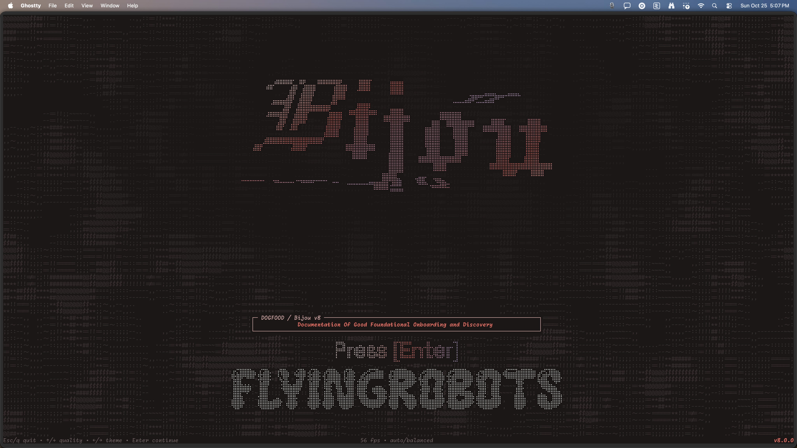
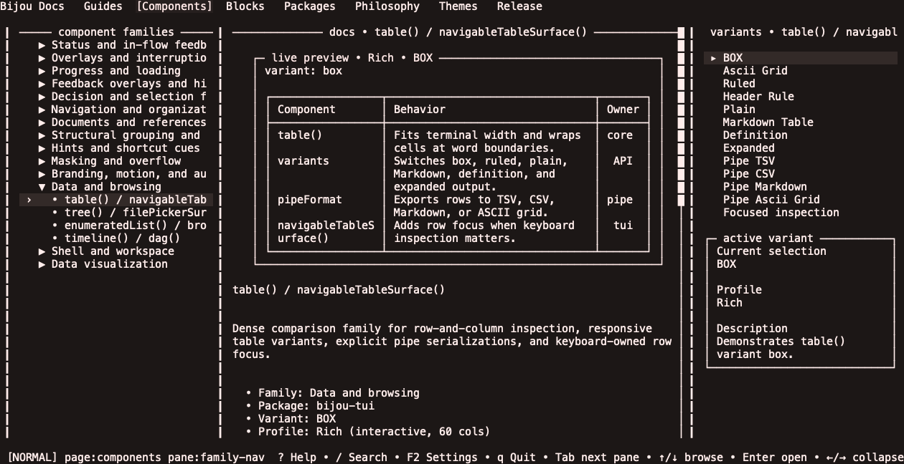
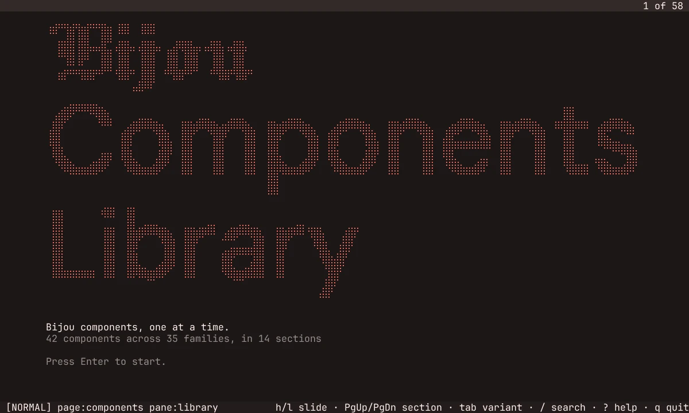

# Bijou


[English](README.md) · [Français](README.fr.md) · [Español](README.es.md) · Deutsch

Baue Terminalanwendungen in TypeScript, von der kleinen CLI bis zur Vollbild-Werkbank.

[Das Lehrbuch lesen](https://github.com/flyingrobots/bijou-job-monitor/blob/main/book/bijou-book.pdf) · [Design-Archiv](docs/book/bijou-archive.pdf) · [Das vollständige Bijou-Dokumentationsbuch lesen](docs/book/bijou-designs.pdf)





DOGFOOD ist mit Bijou gebaut: ein Komponenten-Explorer, eine Live-Dokumentation und ein Ort, um Layouts und Themes auszuprobieren. Das sind echte Ghostty-Screenshots; [siehe Theme Lab und Einstellungen](assets/screenshots/README.md).



Die Components Library zeigt jede Bijou-Komponente Folie für Folie, mit ihren Varianten und ihrer Ausgabe in jedem Modus. Starte sie mit `npm run components`.

## Bijou ausprobieren

Verwende Node.js 22.12 oder neuer und npm und starte dann die oben gezeigte Anwendung:

```sh
git clone https://github.com/flyingrobots/bijou.git
cd bijou
npm ci
npm run build
npm run dogfood
```

Drücke auf dem Titelbildschirm **Enter**. Erkunde mit den Pfeiltasten und **Tab**, öffne die Einstellungen mit **F2** und beende mit **q** oder **Ctrl-C**.

Für ein kleineres erstes Beispiel starte `npm run hello` oder `npm run counter`.

Um Bijou ohne Installation auszuprobieren, öffne die
[Demo-Galerie](https://flyingrobots.github.io/bijou/gallery.html) im Browser:
DOGFOOD, der Soak-Bench und die [Fun-Demos](https://flyingrobots.github.io/bijou/gallery.html?app=fun)
laufen dort auf einem Canvas. GitHub Pages veröffentlicht sie aus `main` (siehe
[`examples/web-gpu`](examples/web-gpu/README.md#published-site)).

## Deine eigene App bauen

Erstelle ein Starterprojekt mit dem veröffentlichten Scaffolder:

```sh
npm create bijou-tui-app@latest my-app
cd my-app
npm install
npm run dev
```

Folge dem **[Job-Monitor-Tutorial](https://github.com/flyingrobots/bijou-job-monitor)**, um zusammen mit dem Lehrbuch eine vollständige Anwendung zu bauen, zu testen und auszuliefern. Für eine winzige App und Hinweise zu den Paketen siehe [Deine erste Bijou-App bauen](docs/guides/getting-started.md).

## Funktionen

- **Komponenten:** Prompts, Formulare, Tabellen, Bäume, Diagramme und wiederverwendbare Blocks.
- **Anwendungslayouts:** Bereiche, Tabs, Schubladen, Overlays und Befehlspaletten.
- **Typisierter Anwendungszustand:** Model, Update und View, mit Befehlen für Effekte.
- **Bewegung und Typografie:** Federn, Übergänge, Farbverläufe und Rasterschriften.
- **Themes und Lokalisierung:** semantische Farbtokens, dunkle und helle Themes und Werkzeuge für Übersetzungen.
- **Ausgabe für verschiedene Umgebungen:** interaktive Terminals, Pipes und barrierefreier Text.

## Neu in v8.0.0

Konfigurierbare Markdown-Schriften, ein animierter DOGFOOD-Titel, vom Buch inspirierte dunkle und helle Themes, umfassendere Theme-Überschreibungen und korrigiertes `NO_COLOR`-Verhalten. Probiere die Typografie-Demo aus mit:

```sh
npm run markdown-font -- examples/markdown-font/sample.md --configure
```

Details zum Release und Änderungen an der Kompatibilität stehen im [Changelog](docs/CHANGELOG.md).

## Weiter geht's

[Dokumentation](docs/README.md) · [Anwendungsleitfaden](docs/guides/getting-started.md) · [Leitfaden für Mitwirkende](docs/development.md) · [Issues](https://github.com/flyingrobots/bijou/issues) · [Lizenz](LICENSE)
