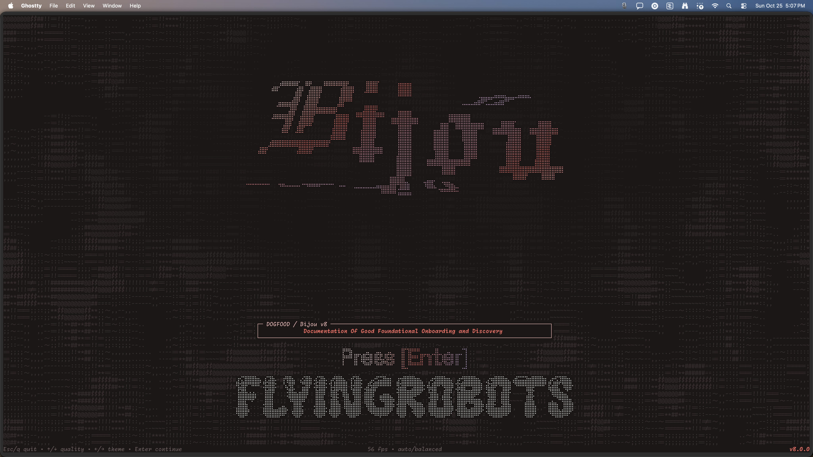
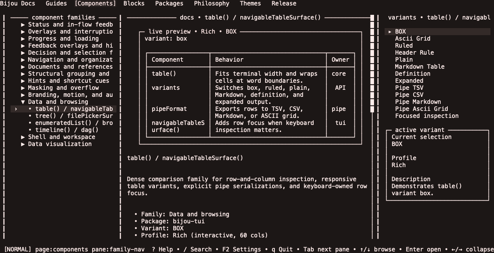
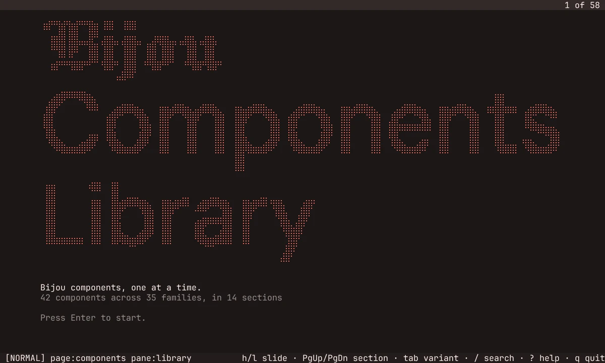

# Bijou


[English](README.md) · [Français](README.fr.md) · Español · [Deutsch](README.de.md)

Crea aplicaciones de terminal en TypeScript, desde una pequeña CLI hasta un banco de trabajo a pantalla completa.

[Lee el libro didáctico](https://github.com/flyingrobots/bijou-job-monitor/blob/main/book/bijou-book.pdf) · [Archivo de diseño](docs/book/bijou-archive.pdf) · [Lee el libro completo de documentación de Bijou](docs/book/bijou-designs.pdf)





DOGFOOD está hecho con Bijou: un explorador de componentes, documentación en vivo y un lugar donde probar diseños y temas. Son capturas reales de Ghostty; [consulta Theme Lab y los ajustes](assets/screenshots/README.md).



La Biblioteca de componentes muestra cada componente de Bijou en una diapositiva, con sus variantes y su salida en cada modo. Ejecútala con `npm run components`.

## Prueba Bijou

Usa Node.js 22.12 o posterior y npm, y luego ejecuta la aplicación que se muestra arriba:

```sh
git clone https://github.com/flyingrobots/bijou.git
cd bijou
npm ci
npm run build
npm run dogfood
```

Pulsa **Enter** en la pantalla de título. Explora con las teclas de flecha y **Tab**, abre los ajustes con **F2** y sal con **q** o **Ctrl-C**.

Para un primer ejemplo más pequeño, ejecuta `npm run hello` o `npm run counter`.

## Crea tu propia aplicación

Crea un proyecto inicial con el generador publicado:

```sh
npm create bijou-tui-app@latest my-app
cd my-app
npm install
npm run dev
```

Sigue el **[tutorial de Job Monitor](https://github.com/flyingrobots/bijou-job-monitor)** para crear, probar y publicar una aplicación completa junto con el libro didáctico. Para una app mínima y una guía de paquetes, consulta [Crea tu primera aplicación Bijou](docs/guides/getting-started.md).

## Características

- **Componentes:** prompts, formularios, tablas, árboles, gráficos y Blocks reutilizables.
- **Diseños de aplicación:** paneles, pestañas, cajones, superposiciones y paletas de comandos.
- **Estado de aplicación tipado:** modelo, actualización y vista, con comandos para los efectos.
- **Movimiento y tipografía:** resortes, transiciones, degradados y fuentes raster.
- **Temas y localización:** tokens de color semánticos, temas oscuros y claros, y herramientas de traducción.
- **Salida para distintos entornos:** terminales interactivas, pipes y texto accesible.

## Novedades de v8.0.0

Fuentes Markdown configurables, un título animado de DOGFOOD, temas oscuros y claros inspirados en el libro, anulaciones de tema más amplias y un comportamiento corregido de `NO_COLOR`. Prueba la demo de tipografía con:

```sh
npm run markdown-font -- examples/markdown-font/sample.md --configure
```

Consulta el [registro de cambios](docs/CHANGELOG.md) para ver los detalles de la versión y los cambios de compatibilidad.

## Sigue explorando

[Documentación](docs/README.md) · [Guía de aplicación](docs/guides/getting-started.md) · [Guía para colaboradores](docs/development.md) · [Issues](https://github.com/flyingrobots/bijou/issues) · [Licencia](LICENSE)
