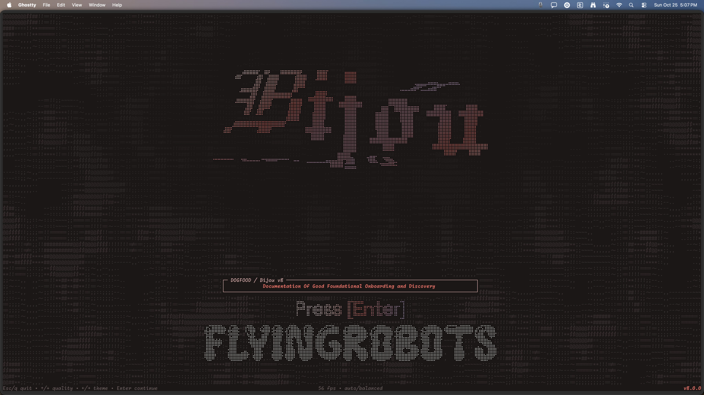
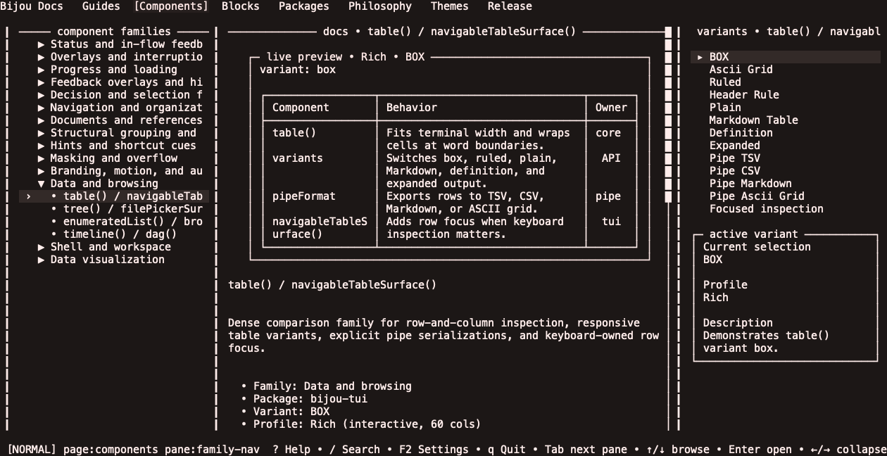
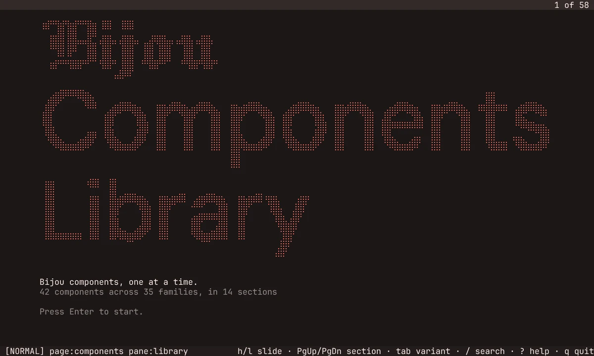

# Bijou


[English](README.md) · Français · [Español](README.es.md) · [Deutsch](README.de.md)

Créez des applications de terminal en TypeScript, d'un petit CLI à un poste de travail plein écran.

[Lire le livre pédagogique](https://github.com/flyingrobots/bijou-job-monitor/blob/main/book/bijou-book.pdf) · [Archive de conception](docs/book/bijou-archive.pdf) · [Lire le livre complet de la documentation de Bijou](docs/book/bijou-designs.pdf)





DOGFOOD est construit avec Bijou : un explorateur de composants, une documentation vivante et un lieu pour essayer des mises en page et des thèmes. Ce sont de vraies captures d'écran de Ghostty ; [voir Theme Lab et les réglages](assets/screenshots/README.md).



La bibliothèque de composants présente chaque composant Bijou, une diapositive à la fois, avec ses variantes et son rendu dans chaque mode. Lancez-la avec `npm run components`.

## Essayer Bijou

Utilisez Node.js 22.12 ou une version plus récente et npm, puis lancez l'application présentée ci-dessus :

```sh
git clone https://github.com/flyingrobots/bijou.git
cd bijou
npm ci
npm run build
npm run dogfood
```

Appuyez sur **Enter** à l'écran titre. Explorez avec les touches fléchées et **Tab**, ouvrez les réglages avec **F2**, et quittez avec **q** ou **Ctrl-C**.

Pour un premier exemple plus simple, lancez `npm run hello` ou `npm run counter`.

## Créer votre propre application

Créez un projet de départ avec l'outil de génération publié :

```sh
npm create bijou-tui-app@latest my-app
cd my-app
npm install
npm run dev
```

Suivez le **[tutoriel Job Monitor](https://github.com/flyingrobots/bijou-job-monitor)** pour construire, tester et livrer une application complète en parallèle du livre pédagogique. Pour une toute petite application et des conseils sur les paquets, consultez [Créer votre première application Bijou](docs/guides/getting-started.md).

## Fonctionnalités

- **Composants :** invites, formulaires, tableaux, arbres, graphiques et Blocks réutilisables.
- **Mises en page d'application :** volets, onglets, tiroirs, surcouches et palettes de commandes.
- **État d'application typé :** modèle, mise à jour et vue, avec des commandes pour les effets.
- **Animation et typographie :** ressorts, transitions, dégradés et polices raster.
- **Thèmes et localisation :** jetons de couleur sémantiques, thèmes sombres et clairs, et outils de traduction.
- **Sorties adaptées à chaque environnement :** terminaux interactifs, tubes et texte accessible.

## Nouveautés de la v8.0.0

Polices Markdown configurables, un titre DOGFOOD animé, des thèmes sombres et clairs inspirés du livre, des remplacements de thème plus étendus et un comportement de `NO_COLOR` corrigé. Essayez la démonstration typographique avec :

```sh
npm run markdown-font -- examples/markdown-font/sample.md --configure
```

Consultez le [journal des modifications](docs/CHANGELOG.md) pour le détail des versions et les changements de compatibilité.

## Pour aller plus loin

[Documentation](docs/README.md) · [Guide de l'application](docs/guides/getting-started.md) · [Guide du contributeur](docs/development.md) · [Tickets](https://github.com/flyingrobots/bijou/issues) · [Licence](LICENSE)
