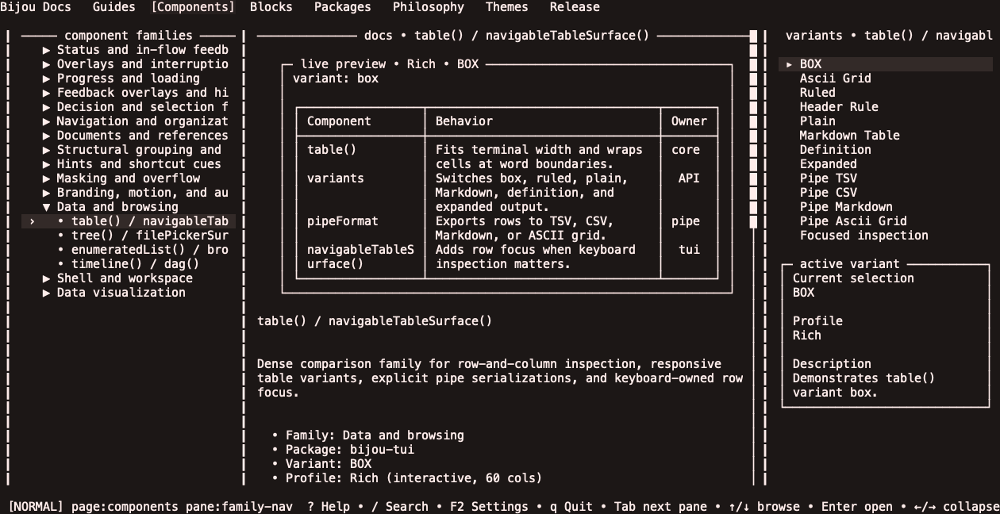
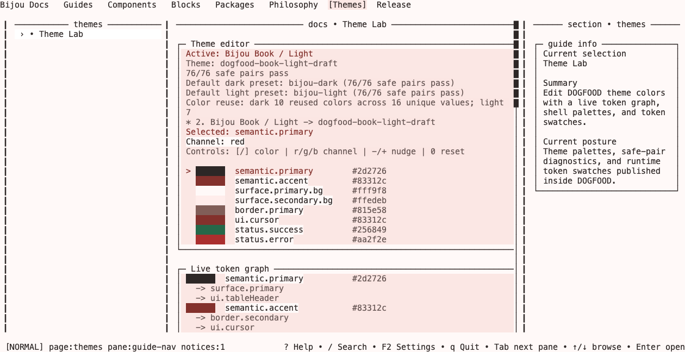

# Bijou

Build terminal applications in TypeScript, from a small CLI to a full-screen workbench.

[Read the teaching book](https://github.com/flyingrobots/bijou-job-monitor/blob/main/book/bijou-book.pdf) · [Design Archive](docs/book/bijou-archive.pdf) · [Read the complete Bijou documentation book](docs/book/bijou-designs.pdf)





DOGFOOD is built with Bijou: a component explorer, live documentation, and a place to try layouts and themes. These are real Ghostty screenshots; [see the title screen and settings](assets/screenshots/README.md).

## Try Bijou

Use Node.js 22.12 or newer and npm, then run the application shown above:

```sh
git clone https://github.com/flyingrobots/bijou.git
cd bijou
npm ci
npm run build
npm run dogfood
```

Press **Enter** at the title screen. Explore with the arrow keys and **Tab**, open settings with **F2**, and quit with **q** or **Ctrl-C**.

For a smaller first example, run `npm run hello` or `npm run counter`.

## Build your own app

Create a starter project with the published scaffolder:

```sh
npm create bijou-tui-app@latest my-app
cd my-app
npm install
npm run dev
```

Follow the **[Job Monitor tutorial](https://github.com/flyingrobots/bijou-job-monitor)** to build, test, and ship a complete application alongside the teaching book. For a tiny app and package guidance, see [Build your first Bijou app](docs/guides/getting-started.md).

## Features

- **Components:** prompts, forms, tables, trees, charts, and reusable Blocks.
- **Application layouts:** panes, tabs, drawers, overlays, and command palettes.
- **Typed application state:** model, update, and view, with commands for effects.
- **Motion and typography:** springs, transitions, gradients, and raster fonts.
- **Themes and localization:** semantic colour tokens, dark and light themes, and translation tooling.
- **Output for different environments:** interactive terminals, pipes, and accessible text.

## What's New in v8.0.0

Configurable Markdown fonts, an animated DOGFOOD title, book-inspired dark and light themes, broader theme overrides, and corrected `NO_COLOR` behaviour. Try the typography demo with:

```sh
npm run markdown-font -- examples/markdown-font/sample.md --configure
```

See the [changelog](docs/CHANGELOG.md) for release details and compatibility changes.

## Keep going

[Documentation](docs/README.md) · [Application guide](docs/guides/getting-started.md) · [Contributor guide](docs/development.md) · [Issues](https://github.com/flyingrobots/bijou/issues) · [License](LICENSE)
