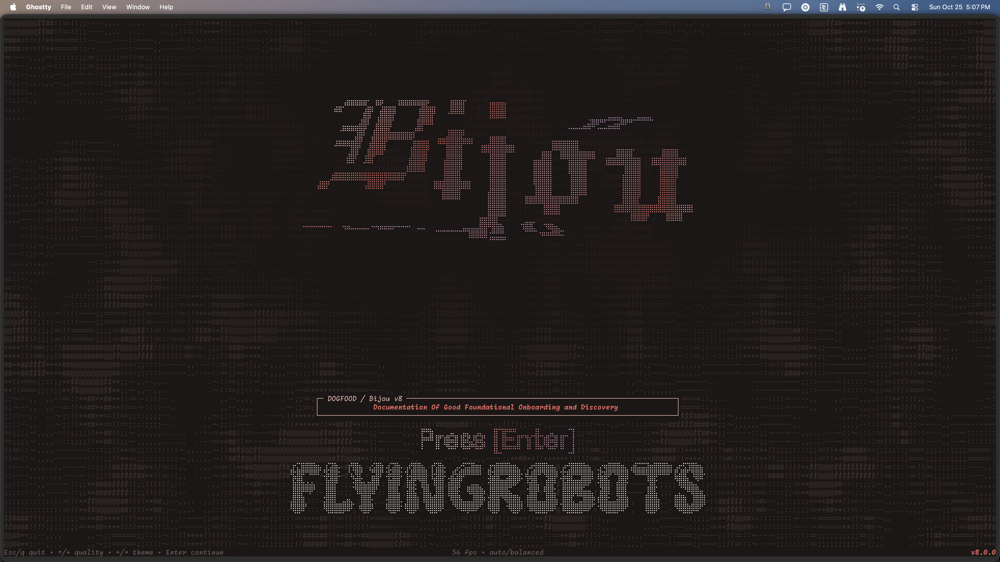
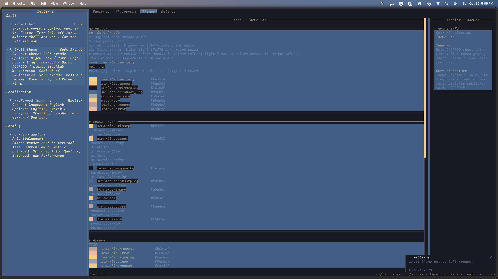

# DOGFOOD in Ghostty

These screenshots were supplied by the maintainer from a live Ghostty session on macOS on 25 October 2026. The PNGs are copied byte for byte: no cropping, resizing, recolouring, font substitution, or cell reconstruction. Their fonts and colours reflect that terminal session.

## Component explorer

## Theme Lab

## Title screen

## Settings

## Provenance

All four images are 4096 × 2304 pixels. The title screen displays version `8.0.0`; the capture commit was not independently recorded, so these images are not commit-bound test evidence. [SHA256SUMS](SHA256SUMS) pins the original PNG bytes.

| Image | Supplied source filename |
| :--- | :--- |
| `dogfood-landing.png` | `Screenshot 2026-10-25 at 5.07.42 PM.png` |
| `dogfood-components.png` | `Screenshot 2026-10-25 at 5.08.38 PM.png` |
| `dogfood-themes.png` | `Screenshot 2026-10-25 at 5.08.46 PM.png` |
| `dogfood-settings.png` | `Screenshot 2026-10-25 at 5.09.04 PM.png` |

The second title capture at 5.07.44 PM was not selected because it includes the macOS screenshot thumbnail overlay.

To refresh this gallery, capture the running application in Ghostty, retain the original PNGs, and update the hashes and source filenames. The former README cell-capture adapter, reconstructed scenes, and CoreText renderer have been removed because they did not preserve terminal appearance.
